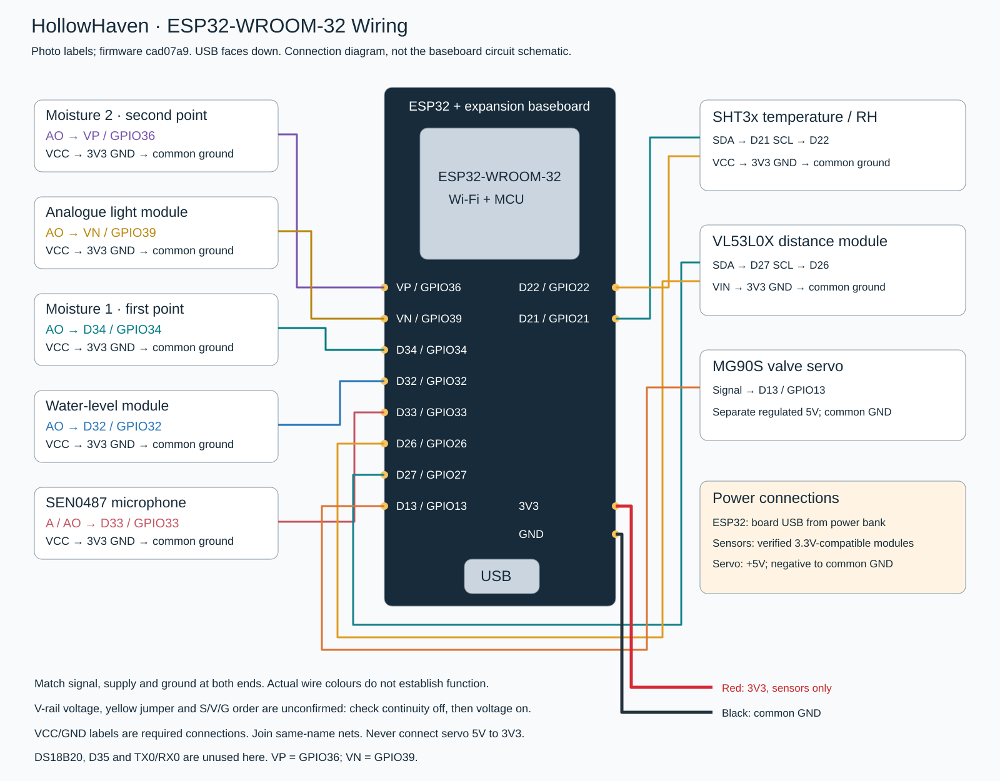

# Wiring diagram and connection table

The embedded diagram shows coloured signal paths. VCC/GND labels beneath each module identify additional required power connections; identically named networks connect together. Colours are illustrative and do not identify the actual jumper wires. Verify terminal labels at both ends of every connection.

Power the ESP32 development board through its USB connector from a standard regulated 5 V USB external supply such as a power bank. Use a computer USB data cable for flashing. Compatible sensors use 3.3 V; the servo uses 5 V with common ground, as shown below.

| Module terminal | ESP32 terminal | Notes |
| --- | --- | --- |
| SHT3x SDA / SCL | D21 / D22 | First I²C bus; do not interchange the two wires |
| SHT3x VCC / GND | 3V3 / GND | Use a 3.3 V-compatible module |
| Moisture 1 AO / VCC / GND | D34 / 3V3 / GND | First wicking-material location |
| Moisture 2 AO / VCC / GND | VP (GPIO36) / 3V3 / GND | Neither D35 nor VN |
| Light AO / VCC / GND | VN (GPIO39) / 3V3 / GND | Use analogue AO, not digital DO |
| Water level AO / VCC / GND | D32 / 3V3 / GND | 3.3 V-compatible module; reading is not continuous volume |
| SEN0487 A / VCC / GND | D33 / 3V3 / GND | Analogue microphone output |
| VL53L0X SDA / SCL | D27 / D26 | Separate second I²C bus |
| VL53L0X VIN / GND | 3V3 / GND | Compatible breakout; leave XSHUT and GPIO1 unused |
| MG90S signal | D13 | PWM; verify the manufacturer's terminal identification |
| MG90S positive supply | Separate regulated 5 V branch | Do not connect to ESP32 3V3 |
| MG90S supply negative | Common GND | Connect to ESP32 ground |

DS18B20 is not connected and its D4 function is disabled. TX0/RX0 are not used for these sensors. All analogue signals must remain within 0–3.3 V. A module with a 5 V output requires an appropriate level interface before connection.
