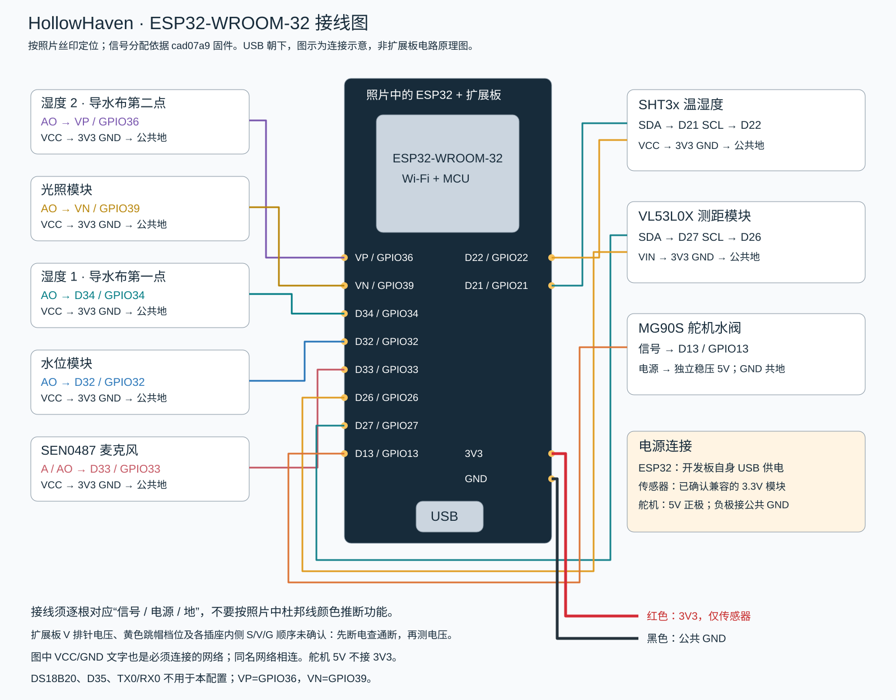

# 接线图与逐线表

下方已嵌入接线图；同目录另附可编辑的“接线图.svg”。图中彩线表示信号，模块下方的 VCC/GND 标签表示必须连接的同名供电网络。图中的线色是识别辅助，不代表实物线色。不要按线色接线，要按端点丝印逐根核对。

ESP32 开发板通过自身 USB 接口连接标准稳压 5V USB 外置电源（如充电宝）；烧录时使用电脑 USB 数据线。传感器使用兼容的3.3V供电，舵机使用5V供电并与ESP32共地，接线见下表。

| 模块端子 | ESP32 端子 | 说明 |
| --- | --- | --- |
| SHT3x SDA / SCL | D21 / D22 | 第一组 I²C；两根不可对调 |
| SHT3x VCC / GND | 3V3 / GND | 使用兼容 3.3V 的模块 |
| 湿度1 AO / VCC / GND | D34 / 3V3 / GND | 导水材料第一点 |
| 湿度2 AO / VCC / GND | VP（GPIO36）/ 3V3 / GND | 不接 D35，也不接 VN |
| 光照 AO / VCC / GND | VN（GPIO39）/ 3V3 / GND | 不使用 DO 数字阈值输出 |
| 水位 AO / VCC / GND | D32 / 3V3 / GND | 模块须支持 3.3V；数值不是连续毫升量 |
| SEN0487 A / VCC / GND | D33 / 3V3 / GND | 模拟声音输出 |
| VL53L0X SDA / SCL | D27 / D26 | 独立第二组 I²C |
| VL53L0X VIN / GND | 3V3 / GND | 采用兼容模块；XSHUT、GPIO1不接 |
| MG90S 信号 | D13 | PWM；核对舵机端子的厂家标识 |
| MG90S 电源正极 | 独立稳压5V | 不接 ESP32 的3V3 |
| MG90S 电源负极 | 公共 GND | 与 ESP32 GND相连 |

当前不接 DS18B20，D4 功能关闭；TX0/RX0 不作为上述传感器端口。全部模拟信号必须限制在 0–3.3V。模块若输出5V，需先设计合适的电平转换，不能直接接入。
