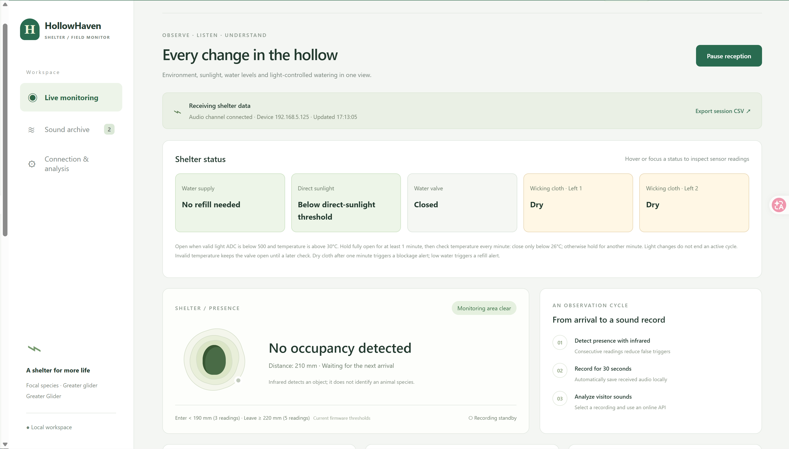
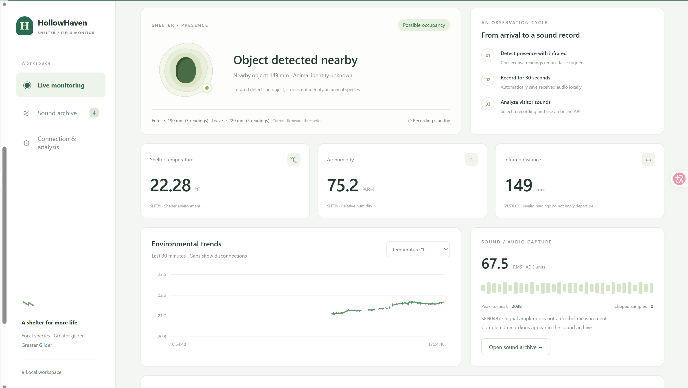
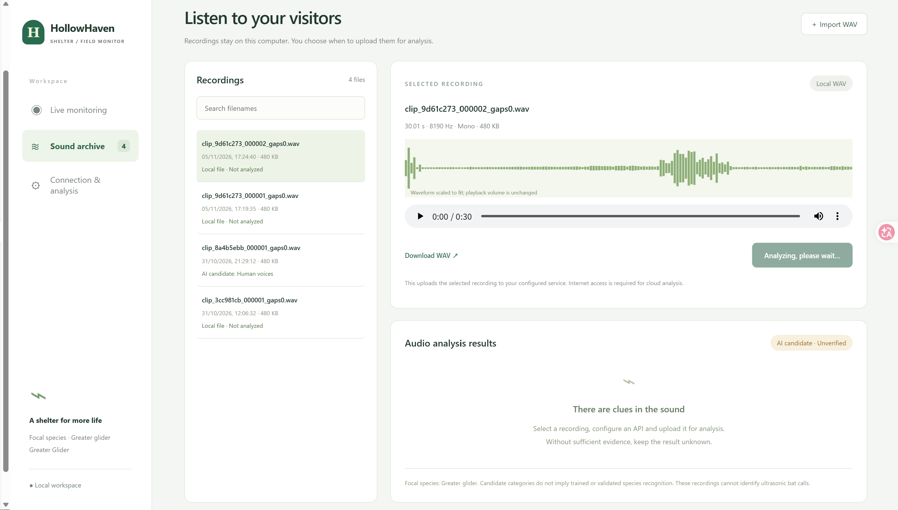
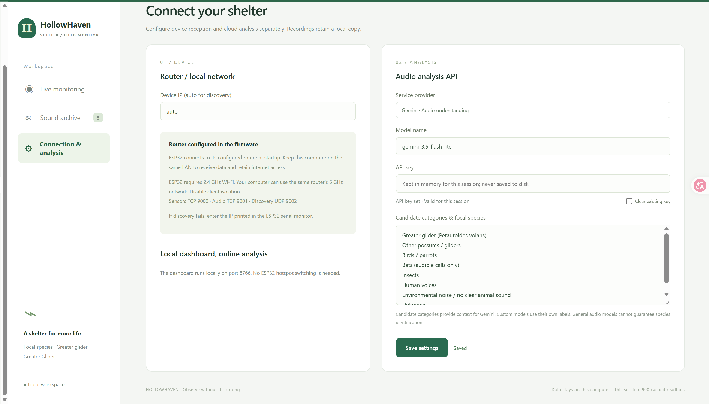

# HollowHaven 智能树洞系统用户手册

适用对象：系统使用者、现场安装人员和维护人员。整理日期：2026年11月2日。

本手册按当前本地项目代码与接线编写。更换开发板、传感器、阀门机构或重新烧录其他版本后，应重新核对接线、阈值与动作方向。文中的 ADC 是传感器原始读数，不直接等于毫升、照度或含水率。

## 1. 系统能做什么

HollowHaven 安装在树上，用 ESP32 采集巢穴温湿度、外部光照、水位、两处导水层湿润状态，以及距离和声音信息。电脑通过同一局域网接收数据，并在网页中显示状态和维护提醒。

当光照和温度达到条件，设备会打开水阀，向与内部空间分开的导水层供水，帮助散热。控制在 ESP32 上运行，电脑关闭或网络断开后仍会执行，但电脑无法继续保存这段时间的实时传感器数据。

系统仍需人工补水、检查管路和供电。动物活动标记和声音 AI 结果用于辅助观察，不能单独确认物种或巢穴是否空置。

### 1.1 使用者与运行条件

HollowHaven 面向负责人工树洞监测的野生动物保护工作人员、研究人员和受过培训的现场志愿者。日常用户查看网页数据、记录异常并安排补水；受过培训的维护人员检修水路和传感器；技术人员负责固件、网络设置和控制阈值。日常监测不需要编程技能。

设备安装于户外树上，用户通常通过同一局域网内的电脑监测，并定期到现场巡检。高温、降雨、网络不稳定和动物占用都会影响维护时间及操作方式。高处作业与电路维修应由具备相应能力的人员完成。接近设备前先检查动物活动，动物占用期间应推迟非必要的侵入式维护。

### 1.2 提供栖息支持，尽量减少干预

我们的核心原则是为动物提供栖息地，支持其生活与生长所需的环境，同时尽量减少人为干预。系统优先观察和记录环境数据，避免采用不必要地改变自然过程、动物行为或日常节律的设计。

动物可以自主选择是否进入、使用或离开树洞。系统不以引导这些选择或控制其日常生活为目的。监测结果用于维护栖息环境，而不是设法让动物使用巢穴。

自动滴水属于对巢穴物理环境的有限干预，目的是支持适宜的栖息条件。其影响应通过温湿度记录和现场观察持续核查。安装、补水和维护应尽量减少扰动，避免不必要的现场访问或接触动物。

## 2. 部署前准备

| 类别 | 需要准备的内容 |
| --- | --- |
| 树洞主体 | 固定牢靠的巢箱、与内部隔开的导水层、可检查和更换的导水材料 |
| 控制与传感 | ESP32、温湿度、光照、水位、两路导水层电容传感器、距离传感器和麦克风 |
| 水路 | 水箱、补水口、与机构匹配的水阀及舵机、进出水管、固定件；建议配置可人工关闭的总阀和便于清理的过滤件 |
| 供电 | 与设备匹配的稳压电源、舵机独立稳压5V供电、共地接线、户外防护和线缆固定；便携电源应确认不会因低负载自动关机 |
| 网络 | 能覆盖安装点的2.4GHz Wi-Fi；接收电脑必须能访问ESP32所在局域网 |
| 接收端 | 一台安装Node.js 18或以上的电脑、项目文件、足够的本地存储空间 |
| 维护工具 | 数据USB线、备用导水材料和管件、清洁用具、记录表，以及适合现场的安全作业工具 |

如使用电池或太阳能，应先测量整机及舵机动作时的耗电，再确定电池、稳压器和充电控制器规格。现有网页没有电池电量或太阳能充电监测，不能通过网页判断剩余供电时间。

## 3. 安装细节

### 3.1 树上固定与防护

1. 使用合适的安装结构，将巢箱、水箱和电子盒分别固定，不能让电线或水管承受箱体重量。固定方式应避免损伤树体，并为树木生长留出空间。
2. 先在地面完成所有功能检查，再上树安装。现场维护前先观察动物活动；避免在动物占用时拆箱或操作洞内器件。
3. 电子部分放入适合户外环境的防护盒，接口使用防水接头并做线缆拉力固定。线缆入盒前留滴水弯，避免雨水沿线进入盒内。
4. 控制盒、供电接头与储水装置分开放置。安排排水路径，防止泄漏、溢水或导水层滴水流向电路和动物居住空间。
5. 为补水、关闭总阀、检查管路和断电保留方便操作的位置。记录安装位置、设备编号、接线照片和水箱容量。

### 3.2 传感器位置

| 部件 | 安装要求 |
| --- | --- |
| 温湿度传感器 | 位于有代表性的内部空气位置，避免紧贴受热壁面、被阳光直接照射、接触湿布或受到滴水；不要堵住通风路径 |
| 两路电容传感器 | 分别监测两个有代表性的导水位置，保持安装深度和接触方式一致；只有探测区域接触导水材料，电路与接插件需按模块防护能力保护 |
| 光照传感器 | 方向和遮挡情况应能代表巢箱实际受光，避免被树叶长期遮住或被维护人员误转方向 |
| 水位传感器 | 固定在与低水位判断相符的位置，避免漂移、污垢和水箱倾斜改变读数 |
| 距离传感器 | 对准目标监测区域，避免箱壁、叶片、水滴遮挡；安装高度变化后重新测空巢距离 |
| 麦克风 | 避开水流、舵机和线缆摩擦声，采取合适的防雨与防风措施，不能用不透声材料完全封住收音区域 |

### 3.3 接线核对

接线、插拔传感器或调整水阀机构前，先断电，并关闭或隔离供水。

| 模块 | ESP32信号引脚 |
| --- | --- |
| SHT3x温湿度 | SDA：GPIO21；SCL：GPIO22 |
| 导水层电容传感器1 | AO：GPIO34 |
| 导水层电容传感器2 | AO：GPIO36（VP） |
| 光照 | AO：GPIO39（VN） |
| 水位 | AO：GPIO32 |
| MG90S水阀舵机 | 信号：GPIO13；使用外部稳压5V并与ESP32共地 |
| SEN0487麦克风 | AO：GPIO33 |
| VL53L0X距离 | SDA：GPIO27；SCL：GPIO26 |

ESP32模拟输入必须在0–3.3V范围内。模块供电按具体模块规格确认，不能把5V模拟输出直接送入ESP32。舵机供电不要依赖ESP32的3.3V引脚。

### 3.4 水路与网络验收

- 地面试水，检查水箱、接头和阀门有无渗漏，确认开阀后两处导水位置均能得到水，关阀后没有持续漏流。
- 储水箱高度会影响重力供水。按实际安装高度试验，并检查软管是否折弯、被固定带压扁或产生阻流气泡。
- 内外隔离结构应实测检查：供水时内部不能出现直接漏水或积水；不能仅凭结构图推断没有水汽影响。
- 当前双网络配置优先尝试预设的ZTE网络，失败后尝试SM-GG。电脑需连接设备最终加入的同一局域网。真实密码由管理员保管，不写入公开手册或Git仓库。
- 路由器或热点关闭客户端隔离。ESP32需要2.4GHz；电脑可使用同一路由器互通的5GHz或有线网络。
- 在树下和最终安装位置都测试数据连接，并观察舵机动作时是否掉线或重启。手机热点应确认兼容模式、覆盖范围和持续开启条件。

## 4. 日常使用步骤

1. 确认水箱有水、管路通畅、电子盒干燥、各部件固定可靠，再接通电源。设备上电发出关阀命令，应确认机械阀实际关闭。
2. 将电脑连接到ESP32所在局域网。在项目的`website`文件夹双击`HollowHaven.cmd`。
3. 浏览器打开 <http://127.0.0.1:8766/>。这是真实设备数据网页；`nest-microclimate-english.html`是已保存的实测曲线页面，不接收实时传感器数据。
4. 在连接设置中将设备地址设为`auto`，保存后点击连接。自动发现失败时，可由管理员通过USB串口读取设备IP并手动填写。
5. 确认传感器通道已连接、数据持续更新，再查看温湿度、水位、两路导水层和阀门状态。音频通道空闲且没有新录音，不一定表示故障。
6. 页头可切换English／中文。声音分析需选择录音并手动发起；API密钥仅保存在当前服务进程内存，服务重启后需重新输入。使用外部AI可能产生费用。
7. 持续记录时，让电脑保持供电、联网和唤醒，后台服务持续运行。关闭网页不会停止后台接收；电脑关机、休眠或停止服务会中断接收。
8. 要结束接收，在`website`目录执行`./stop.ps1`。停止网页接收不等于关闭树上的供水或设备。

后台发现设备使用UDP 9002，传感器TCP 9000，音频TCP 9001。若防火墙阻挡，应由管理员按这些端口配置局域网访问，不需要把它们暴露到公网。

## 4A 网页功能与操作图解

以下图片为团队提供的实际网页截图，页面数值是截图时刻的读数。截图中的 IP、模型名称和文件名仅为该次配置，使用时填写本机实际值。中文手册保留原始英文界面截图，并在文字中对照按钮名称。

### 实时监测与 CSV 导出

打开 Live monitoring（实时监测），确认 Receiving shelter data 和更新时间持续变化。查看供水、直射光、水阀及两处导水布状态；悬停或键盘聚焦状态卡可查看原始读数。Closed/Open 表示阀门命令状态，实际水流需现场确认。

点击 Export session CSV 下载当前 Node.js 服务会话的数据。该文件不合并所有历史会话。Pause reception 暂停电脑接收；再次连接可恢复。暂停不会关闭 ESP32 或停止本地滴水控制，也不会补齐暂停期间的遥测。

### 传感器读数、趋势与事件

在 Environmental trends 的下拉框选择温度、相对湿度、距离或 Sound RMS。图表显示最近约30分钟的可用数据；断线或无效值造成的间断不能理解为零读数。声音 RMS 是 ADC 幅度指标，不是分贝。

Object detected nearby 表示附近目标达到检测条件，不能确认动物身份。进入事件触发约30秒录音，录音和传输结束后再去档案页查看。图中149 mm为当时读数，不是新的触发阈值。持续停留不会连续产生进入事件。

### 录音档案、导入与分析

点击 Sound archive，用 Search filenames 查找文件并选中录音。右侧显示时长、采样率、声道、大小和波形；使用播放条试听或拖动进度，点击 Download WAV 保存副本。波形自动缩放，不能据此比较不同文件的绝对音量；图中8190 Hz仅代表所选文件。

点击 Import WAV 选择不超过8 MiB的16位PCM WAV。支持单声道或双声道，采样率1000–192000 Hz。导入后文件进入本地档案，不会自动上传到云端。列表最多显示最近250个文件，这不意味着旧文件已被删除。

先在设置页配置分析服务，再选中文件点击 Upload & analyze audio。Analyzing, please wait 表示任务进行中，等待结果后查看候选标签、依据与不确定性。上传只在主动发起时发生；云端分析需要网络和有效账户配置。失败时检查服务、模型、密钥和连接，原始录音仍保留在本地。AI candidate / Unverified 不代表已确认物种。

### 连接与分析设置

进入 Connection & analysis。Device IP 通常填写 auto；发现失败时使用设备串口显示的实际局域网IP，不要照抄截图。电脑与ESP32须在可互通的局域网内。

在 Service provider 选择服务，填写该服务实际支持且账户可用的 Model name；截图中的模型字符串不是兼容性保证。自定义服务需填写对应的API地址。填写API key，按需编辑候选类别，再点击 Save settings 并确认保存反馈。候选类别提供上下文，不会训练或验证模型。

密钥仅留在运行中的服务器内存，重启后需重新输入。勾选 Clear existing key 并保存可清除密钥。保存设置不会自动分析录音。界面顶部的语言选择可切换中英文。

## 5. 自动滴水规则

| 条件或状态 | 当前行为 |
| --- | --- |
| 有效光照ADC <500，同时有效内部温度 >30°C | 发出开阀命令 |
| 舵机已达到完全打开的输出命令 | 从此时起至少保持60秒 |
| 满60秒后的检查中，温度 <26°C | 发出关阀命令 |
| 温度 ≥26°C，或温度无效 | 继续保持开启，60秒后再检查 |
| 开启后光照发生变化 | 不会单独终止这次供水周期 |
| 水位过低 | 提示维护；当前不会自动禁止开阀或关闭阀门 |

完整舵机行程约13秒。开阀脉宽1200μs，关阀2500μs，是当前机构的配置；重新装配后需验证方向及行程，避免机械顶死。网页阀门状态表示控制命令，没有机械位置或流量反馈。

炎热条件下温度可能长时间降不到26°C，水阀会持续开启。当前没有最大供水时长或低水位联锁，应实测耗水量并安排补水和人工关闭供水的方法。30°C和26°C是工程控制阈值，不是已验证的动物舒适温度界限。

## 6. 哪些参数表示需要维护

| 网页参数或现象 | 当前规则／含义 | 应采取的措施 |
| --- | --- | --- |
| 水位ADC <50，显示补水或“小于50ml” | 低水位告警；“50ml”为已有标签，不能作为已校准的体积读数 | 现场查看实际水量，补水后检查读数变化；同时检查漏水和水位传感器污垢 |
| 任一路导水层ADC ≥2300 | 该点判为干燥 | 开阀后观察是否变湿；若长期干燥，检查缺水、阻塞、接触不良或传感器故障 |
| 导水层ADC <2000 | 该点判为湿润 | 与现场状态核对；关水很久仍显示湿，不一定故障，也可能是材料仍有存水 |
| ADC处于2000–2300 | 保持上一次干／湿状态；初始或无效时可能未知 | 不依据单个中间读数判断故障，观察趋势并检查安装接触 |
| 完全开阀满60秒，任一路仍判干燥 | 可能堵塞告警 | 检查水箱、总阀、软管、出水口及导水材料；该提醒不能区分堵塞和其他供水故障 |
| 水阀已开、实际水位下降，但某路电容ADC没有可辨识变化 | 电容传感器疑似故障；也可能是漏水、导水未到达该点或接线问题 | 确认该探测位置已实际变湿，检查接线，再做受控干湿对比；读数仍无响应时更换该路传感器 |
| 阀门显示打开，但无水流 | 软件命令与实际水路不一致 | 检查舵机供电、连接机构、阀门行程及管路，必要时人工隔离供水后检修 |
| 温度持续升高、供水后无改善 | 需要检查实际散热效果；不是单靠某个温度就能确诊设备故障 | 核对受光、供水和传感器位置，检查导水覆盖；记录完整曲线，避免只比较瞬时值 |
| 相对湿度异常上升或出现内部水滴 | 可能是降温、天气变化、漏水或通风变化 | 查看温度变化，现场检查隔水层、排水和通风；内部漏水应先隔离供水处理 |
| 温湿度显示未知、无效或明显不合理 | 数据不可用或传感器异常 | 检查供电、插头、I²C接线、结露与损坏；开阀期间温度无效不会自动关阀，应及时现场检查 |
| 数据超过约6秒未更新或显示过期 | 网页无法确认最新状态 | 检查设备供电、Wi-Fi、电脑休眠与后台服务；旧数值不能代表此刻状态 |
| 经常掉线／出现设备重新启动 | 网络或供电等原因待排查 | 先记录时刻，检查是否与舵机动作相关，再检查稳压电源、接头、信号和热点 |
| 距离长期无效、读数固定或占用状态不合理 | 可能遮挡、结露、安装变化或接线问题 | 清理光学窗口、检查方向并重测空巢距离；不能把无效读数解释为动物离开 |
| 麦克风数据异常或录音只有噪声 | 可能受水流、风、机构振动或供电影响 | 播放原录音，检查安装与防护；声音强度不是已校准分贝值 |

距离占用的当前试验门限为：连续3次读数≤189mm标记接近，连续5次读数达到退出条件（220mm门限）确认离开。它依赖安装几何，应由管理员核对实现和实测空巢距离后使用，不能直接作为动物体型判断。

原始ADC可能在断线时仍显示一个看似合理的数，尤其是悬空模拟输入。维护时应把现场检查、读数变化和告警结合起来，不能只看是否有数字。

## 7. 维护方法与建议频率

以下频率为初始运维建议，需根据实际耗水、天气、污垢和掉线情况调整。

| 时间或触发条件 | 维护项目 |
| --- | --- |
| 安装后首日、首次高温供水后 | 检查温湿度曲线、实际出水与关水、两处湿润情况、漏水和供电稳定性 |
| 每日远程查看；高温天增加查看次数 | 确认数据新鲜、补水和堵塞提醒、阀门开多久、是否反复重启，以及电脑存储空间 |
| 按实测耗水安排，低水位时立即检查 | 补水并记录补水量；持续供水时缩短检查间隔 |
| 建议每周现场检查；大风暴雨后追加 | 检查固定件、线缆、电子盒进水、管路、导水层、传感器位置和树体固定余量 |
| 建议每月及更换部件后 | 复核传感器、低水位判断、阀门全行程、实际出水和空巢距离；备份数据 |

### 7.1 补水与疏通

先观察是否有动物活动，再按现场流程接近。补水前检查电路与供电接头干燥，避免水洒向电器。使用适合系统材料与动物栖息环境的清洁水源，盖好水箱，减少杂物进入。

出现堵塞提醒时，先看水箱是否有水、人工总阀是否打开，再检查软管折弯、过滤件、阀门和出水口。需要拆管或清洁时先隔离供水并断开相关电源。清理后在可观察条件下试水，确认两路导水层读数变湿、内部无漏水、关阀能停止出水，再恢复运行。不要仅清除网页告警就认为故障已解决。

### 7.2 传感器与导水层

断电后按模块允许的方法清理水位探头和传感器表面，不把非防水电路浸水。导水材料出现破损、严重污垢或润湿明显不均时更换。更换后保持原传感器位置并重新验证干／湿读数；不适配时由管理员修改阈值并重新烧录。

温湿度传感器可与可信参考仪器并排比较，避免用手直接捂住后马上读数。水位传感器用实际加水量验证低水位提醒。光照门限需在现场受光和遮阴条件下核对，不把ADC直接写成lux。

### 7.3 电容传感器疑似故障告警与更换

判别现象：水阀已经打开，现场确认水位持续下降，但一路或两路电容传感器的原始ADC在导水过程中没有可辨识变化。应查看原始ADC趋势，不能仅凭“干／湿”标签没切换判断故障，因为标签带有滞回区间。

目前这是一条新增的人工巡检判据，尚未实现为网页或固件的自动告警。当前水位ADC未做连续体积标定，不能把短时ADC下降直接等同于确定的耗水量。“无变化”的时间窗口和变化容差也需通过正常润湿测试确定，不直接设为精确相等或随意指定数值。

1. 查看数据时间，确认正在读取新数据，排除掉线导致的数值停留。
2. 现场确认水从预期路径流出，并已到达该传感器所在的导水材料。水位降低但该处仍干，先排查漏水、分流、接触不良和导水不均。
3. 隔离供水并断电，检查该路电源、地线、AO线、接插件及探测面。恢复供电后，在可观察条件下进行干燥与湿润对比，不浸湿模块非防水电路。
4. 如果探测位置确实由干变湿、接线正常，而原始ADC仍无响应，则将该传感器判为故障并更换。必要时由技术人员换用已知正常模块，区分传感器故障与线缆或ADC输入故障。
5. 更换前隔离供水并断电，按原位置、原深度安装同规格模块。传感器1接GPIO34，传感器2接GPIO36，确认输出在0–3.3V范围内。
6. 重新进行干湿读数、供水和关水测试，确认读数随润湿变化且状态正确。如新模块不适配原有2000／2300门限，先重新标定，由管理员更新配置；复测完成后再恢复树上运行并记录换件情况。

### 7.4 掉线排查

1. 确认ESP32仍供电，检查电源灯、接头和电子盒是否进水。
2. 确认电脑与设备实际加入同一局域网；设备切换到备用网络后，电脑也需能访问该网络。
3. 检查热点是否仍开启、是否为2.4GHz兼容模式、信号是否被树干和安装盒遮挡。
4. 确认后台服务运行，电脑没有休眠。网页用`auto`重新发现；不要一直使用可能已变化的旧IP。
5. 仍失败时由维护人员在安全条件下重启设备，必要时接USB查看断网或重启日志。反复重启不是长期修复方法。

### 7.5 停机与故障处置

发生漏水、电子盒进水、舵机持续卡住或明显异常发热时，先在安全可操作的位置隔离供水并断电，再安排检修。断电后舵机不会继续执行关阀，因此应通过人工总阀或断开供水源确保停止供水。重新上线前按首次部署步骤复测。

## 8. 数据保存与交接

- 实时传感器数据保存在接收电脑的`website/data/session_*.csv`；录音保存在`website/recordings/`。
- 电脑未接收期间，ESP32不会补传完整历史传感器序列。网络恢复后数据缺口仍存在，记录报告中应标注。
- 当前设备录音采用有限循环存储，不能替代长期备份；收到录音后定期备份电脑上的文件。
- 维护记录至少包含：设备编号、时间、故障现象、现场水量、相关ADC、阀门状态、处理措施、换件情况与复测结果。
- 区分历史实测记录与实时设备读数。历史曲线页面不能用于判断当前现场是否需要补水或检修。
- 更换电脑时移交项目、记录和非敏感配置；API密钥和Wi-Fi密码通过管理员指定方式单独配置。

## 9. 上树前验收清单

- [ ] 接线正确，模拟输入不超3.3V，舵机外部5V供电且共地。
- [ ] 箱体、水箱和电子盒固定可靠，线缆有拉力固定、防水入口和滴水弯。
- [ ] 实际开阀出水、实际关阀止水，两处导水层均能润湿。
- [ ] 供水过程中内部无直接漏水或积水，排水路径避开电路和动物空间。
- [ ] 模拟低水位时能提醒，明确低水位没有自动停水联锁。
- [ ] 验证导水层干湿判断；缺水／阻流测试在受控、可及时停止供水的条件下进行。
- [ ] 上电关阀、升温开阀与一分钟检查逻辑已在地面受控测试中验证。
- [ ] 安装位置能连续收数据；舵机动作时没有复位或供电中断。
- [ ] 电脑后台运行和不休眠配置已确认，CSV和录音可保存、可备份。
- [ ] 负责人知道如何补水、人工隔离供水、断电，以及何时安排现场检查。

技术依据：`project/CURRENT_SETUP.md`、`project/firmware/main/project_config.h`、`project/shared/valve_control.h`、`website/README.zh-CN.md`及当前服务实现。
